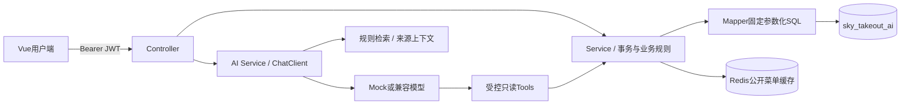
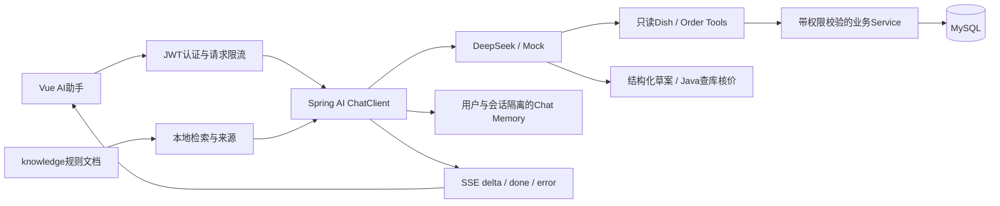
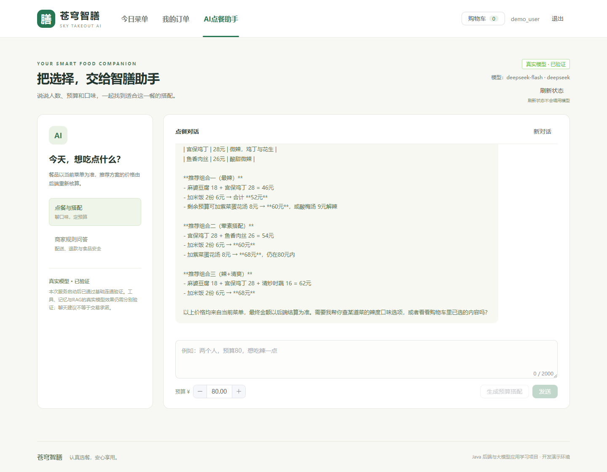
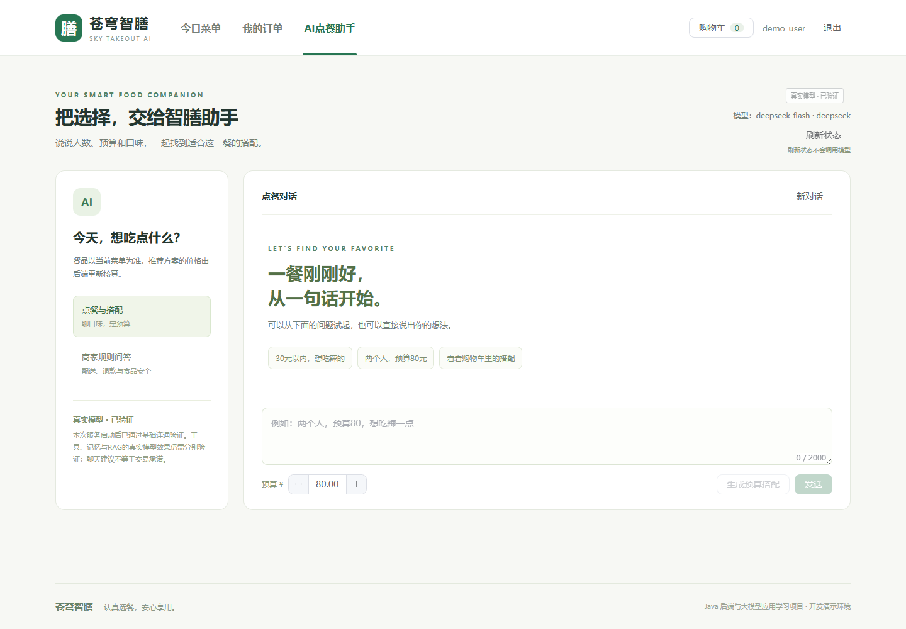

# 苍穹智膳 SkyTakeout AI

**基于 Spring Boot + Vue3 + Spring AI + DeepSeek 的智能外卖平台。**

## 项目简介

Java 外卖业务与大模型应用学习项目：先用确定性的后端实现菜单、购物车和订单，再让AI通过受控工具读取真实业务数据。Maven多模块单体 + Vue用户端，适合按阶段阅读和练习。

**发布前复测（2026-10-04）：后端83项、前端7项测试通过，前端生产构建成功；真实DeepSeek调用、Dish Tool Calling、Chat Memory、Structured Output、RAG、Order Tool和SSE已完成独立验证。Docker配置与健康检查编译通过，完整镜像部署尚未验收。详见[真实AI记录](docs/REAL_AI_VERIFICATION.md)与[发布前检查](docs/GITHUB_RELEASE.md)。普通测试不调用收费API。**

先读 [完整审计](docs/AUDIT.md) 与 [最新验收报告](docs/ACCEPTANCE_REPORT.md)，历史进展见 [夜间报告](docs/NIGHTLY_REPORT.md)，学习过程见 [LEARNING](docs/LEARNING.md)，面试准备见 [INTERVIEW](docs/INTERVIEW.md)。

## 技术栈

| 层次 | 版本/实现 |
| --- | --- |
| Java / Maven | Temurin 17.0.20.1 / Maven 3.9.11，已验证开发环境 |
| 后端 | Spring Boot 3.5.16、MyBatis-Plus 3.5.17、Jakarta Validation |
| 数据库 | 本机MySQL 8.0.44，InnoDB；Docker方案采用MySQL 8.4但未启动验收 |
| 认证 | BCrypt成本12、JJWT 0.13.0、Interceptor、UserContext |
| 缓存 | Spring Cache + Redis；本机Redis 3.0.504真实测试通过 |
| AI | Spring AI 1.1.8，OpenAI-compatible ChatModel / ChatClient |
| 前端 | Vue 3.5.43、Vite 8.3.2、Element Plus 2.14.7、Axios 1.20.0、Pinia 4.0.3 |
| 本机工具 | Node 24.14.1 / npm 11.11.0 / Git 2.53.0 |

依赖版本以pom.xml和package-lock.json为准。项目引入MyBatis-Plus依赖，实际Mapper主要使用参数化注解SQL，未伪装成完整使用其所有功能。

## 项目目录与系统架构

```text
sky-common/       Result、错误码、业务异常、认证上下文
sky-pojo/         数据记录、输入DTO、组合VO、统计结果
sky-server/       Controller → Service/Impl → Mapper，以及认证/缓存/AI
sky-web/          Vue用户端
sql/              01建库、02—06建表、最后执行演示seed（仅新项目库）
knowledge/        5份明确标记的教学规则
scripts/          预览启停、真实AI启动与限时Probe、可选管理员初始化
Dockerfile        后端构建与运行镜像（未完成构建验收）
docker-compose.yml  MySQL、Redis、backend、frontend、nginx
```



三个Maven模块仍在一个JVM内，不是微服务。认证身份只来自JWT；userId不由前端或模型指定。Controller不直接操作Mapper，金额使用BigDecimal，下单时重新查询数据库核价并保存快照。

## 核心功能与边界

- 普通用户注册登录；独立员工登录；菜单分类、菜品与口味、套餐及组成；购物车合并/减量/清空；订单创建、幂等、详情、历史、取消、再次加入购物车。
- 管理员通过API维护分类/菜品/套餐、顺序推进订单状态、获取AI经营分析。**本版没有管理后台页面。** 本轮已按明确授权导入开发演示账号与菜单；管理员功能仍通过API使用。
- 订单状态：PENDING_PAYMENT → WAITING_ACCEPT → PREPARING → DELIVERING → COMPLETED；用户可在前两种状态取消。管理员推进到WAITING_ACCEPT仅为教学模拟，**没有真实支付或退款**。
- AI聊天、只读业务Tools、多轮Memory、预算套餐、SSE、RAG规则问答、管理员聚合统计。优惠券/会员/配送规则是示例知识，没有实现优惠券、积分、评价或真实配送服务。
- 菜品支持详情与口味选择，套餐支持查看搭配；口味是免费备注，不是付费规格，不改变价格。

## 数据库初始化

唯一新库为 **sky_takeout_ai**，旧库 **sky_take_out** 禁止读写、修改、删除或复用。连接URL固定新库名，不接受DB_NAME覆盖。完整表结构与关系见 [DATABASE_DESIGN](docs/DATABASE_DESIGN.md)。

本机新库和10张表已实查并导入演示数据，不需要重新初始化。新机器先执行下方六份DDL，最后才运行02_seed_demo_data.sql。DDL只CREATE IF NOT EXISTS；演示脚本只插入缺失数据，不覆盖账号密码。Seed按名称匹配，仅用于空库或本脚本的专用演示菜单，不保证适用于任意已有重名菜单或并发导入。实际结构见docs/DATABASE_SCHEMA_ACTUAL.md。

```powershell
# 仅用于新环境：进入项目根目录，在交互提示中输入数据库密码
mysql -h 127.0.0.1 -P 3306 -u root -p
```

```sql
SOURCE sql/01_create_database.sql;
SOURCE sql/02_auth.sql;
SOURCE sql/03_catalog.sql;
SOURCE sql/04_setmeal.sql;
SOURCE sql/05_cart.sql;
SOURCE sql/06_orders.sql;
SOURCE sql/02_seed_demo_data.sql;
SELECT DATABASE();
```

最后应为sky_takeout_ai。不执行DROP DATABASE，也不向旧库执行任何命令。

## 本机启动

在项目根目录打开PowerShell。以下用于普通回归与Mock预览，仅设置当前终端，不改系统JAVA_HOME/PATH，也不删除JDK11。真实DeepSeek模式使用下方独立入口。请先按数据库初始化章节准备自己的新项目数据库。

```powershell
$env:JAVA_HOME = 'C:\path\to\jdk-17' # 替换为自己的JDK 17安装目录
$env:Path = "$env:JAVA_HOME\bin;$env:Path"
$env:DB_USERNAME = 'root'
$secret = Read-Host '本机MySQL密码' -AsSecureString
$env:DB_PASSWORD = [Net.NetworkCredential]::new('', $secret).Password
$secret.Dispose()
$env:JWT_SECRET = [Convert]::ToBase64String([Security.Cryptography.RandomNumberGenerator]::GetBytes(32))
$env:AI_MODE = 'mock'
$env:CACHE_ENABLED = 'true'
$env:RUN_DB_TESTS = 'true'
mvn -B -ntp clean package
# 必须看到83项测试、0失败、0错误、0跳过和全部模块SUCCESS后启动
java -jar sky-server/target/sky-server-0.0.1-SNAPSHOT.jar
```

后端http://127.0.0.1:8080/health。Redis使用现有服务127.0.0.1:6379；日常无Redis可以CACHE_ENABLED=false启动，但完整缓存测试需要Redis。DB_PASSWORD不要打印、保存到文件或发给他人。终端结束后凭据随进程消失；也可用Remove-Item Env:DB_PASSWORD清除。停止正在运行的JAR后再执行mvn clean，Windows会锁定运行中的JAR。

另开终端：

```powershell
cd sky-web
npm ci
npm run dev
```

浏览器http://127.0.0.1:5173，Vite把/api代理到8080。`npm run build`生成dist；不能直接双击index.html代替HTTP服务。登录信息仅在sessionStorage保存，后端仍对每次请求鉴权。

### 固定15173预览入口

若使用本次验收的15173入口，在已安全设置DB_PASSWORD的同一终端、已完成构建和npm依赖安装后执行下方命令，替代分别启动Java和Vite：

```powershell
./scripts/Start-Preview.ps1 -JavaHome $env:JAVA_HOME
```

脚本配对启动8080和15173，显式设置代理目标；先验证真实数据库连接、库名与SELECT 1，再验证15173/api/health/ready，成功后才报告ready。AI模式可由`-AiMode mock`或`-AiMode live`明确指定；省略时继承当前终端AI_MODE，未设置才默认Mock，不会把已选live静默改回Mock。敏感启动变量只交给Java后端；启动Vite时移除AI_API_KEY、DB_PASSWORD、JWT_SECRET等敏感变量，再恢复父进程环境。缺少JWT_SECRET时临时生成，不保存。占用端口时直接拒绝，不终止未知服务。脚本报告ready后访问15173；再次启动前用`./scripts/Stop-Preview.ps1`核对并停止本项目记录的实例。PID及非敏感日志在Git忽略的logs/preview/。不要仅凭/health=200判断数据库可用。

### 真实模型启动与最小验证

项目已完成真实DeepSeek API验证，证据见[REAL_AI_VERIFICATION](docs/REAL_AI_VERIFICATION.md)。新使用者先在当前终端安全加载`AI_API_KEY`、`DB_PASSWORD`和仅用于本地演示的`DEMO_PASSWORD`，再从项目根目录执行下列命令；后端JAR、JDK 17及前端依赖须已准备好。可通过`Read-Host -AsSecureString`读入Key并转换到进程环境，切勿把真实值写进命令示例或提交到Git：

```powershell
.\scripts\Start-DeepSeek.ps1
```

该入口优先使用进程已有的`AI_API_KEY`，公开仓库不依赖任何个人旧项目。只有需要兼容自己授权的旧配置时，才传入`-LegacyEnvPath <自己的配置文件>`（或设置`SKY_LEGACY_ENV_PATH`），读取其中的`LLM_API_KEY`并校验供应商。旧文件不修改，Key不写入本项目；结束后恢复调用者原有AI环境变量。入口统一设置`AI_MODE=live`、`AI_BASE_URL=https://api.deepseek.com`、`AI_MODEL=deepseek-flash`，不沿用旧模型名。当前模型名见[DeepSeek更新日志](https://api-docs.deepseek.com/updates/)与[官方调用说明](https://api-docs.deepseek.com/)。

可选的`.local/startup.json`只保存`LegacyEnvPath`与`JavaHome`两个路径，受到`.gitignore`和`.dockerignore`保护，不应写入Key或密码。优先级为显式参数、对应环境变量、该本机文件；仓库没有该文件也能用`AI_API_KEY`和`JAVA_HOME`正常启动。原开发机保留此忽略文件兼容既有一键启动方式，未修改旧项目。

入口依次校验并停止本项目旧预览、启动固定8080/15173配对服务、确认数据库与代理就绪，再执行最小Probe。它需要DB_PASSWORD与DEMO_PASSWORD已在环境中，缺失立即停止，没有隐藏输入等待。独立运行`Test-AiLive.ps1 -Stage Probe`时，缺少DEMO_PASSWORD立即输出`LIVE_PROBE=FAIL category=LOCAL_CREDENTIALS_MISSING`。本项目不使用AI_ENABLED、AI_PROVIDER或额外Spring profile作为开关。

最小Probe固定“你好”、最多64输出token，不带Tools/Memory/RAG，不重试；同一后端进程成功后缓存结果，不追加问候请求。Probe脚本默认总预算45秒（预留1秒清理），本机就绪/登录/状态读取各最多5秒，单次Probe最多40秒，后端生成总截止35秒；所有本机请求还受剩余总预算约束。终端显示安全阶段进度及`LIVE_PROBE=PASS`或`LIVE_PROBE=FAIL category=...`，不打印Key、JWT或模型回复。45秒不包括前面的服务启动等待。

`Start-Preview.ps1`与网页“刷新状态”不调用模型；`Start-DeepSeek.ps1`默认包含显式Probe，应按真实模型操作使用。网页“真实模型 · 已验证”只代表当前进程基础Probe成功。当前Probe、Dish/SSE、Memory、Structured Output、RAG、Order均已通过；范围与操作说明见[AI_LIVE_VERIFICATION](docs/AI_LIVE_VERIFICATION.md)，最终证据以[REAL_AI_VERIFICATION](docs/REAL_AI_VERIFICATION.md)为准。

### 创建自己的管理员与菜单

管理员只能通过显式离线命令创建，没有开放注册接口；开发演示账号已提供，可选创建自选管理员。先按上面的步骤打包并在当前终端配置DB_PASSWORD和JWT_SECRET，再运行：

```powershell
.\scripts\Initialize-Admin.ps1 -Username your_admin_name
```

按隐藏提示输入自选管理员密码（12—64字符，UTF-8不超过72字节）。命令校验新库catalog，存BCrypt哈希，已有同名员工直接失败，不覆盖。该可选初始化分支已编译，未在本机实际创建账号；需要你自行选择凭据后操作。

通过POST /admin/auth/login拿到token后，用HTTP客户端调用以下接口，Header为Authorization: Bearer TOKEN（不要保存真实token到仓库）：

```text
POST /admin/categories
{"name":"热菜","type":1,"sort":0}

POST /admin/dishes
{"categoryId":上一步返回ID,"name":"宫保鸡丁","price":28.00,"description":"教学菜品","image":"","flavors":[]}

PUT /admin/dishes/返回ID/status?status=1
```

新菜品默认下架，必须上架后普通用户才能看到。套餐分类type=2，套餐组成通过dishes数组提交dishId和quantity。此文档示例不会自动执行或向数据库插入演示菜单。

## 环境变量

| 变量 | 默认值 / 说明 |
| --- | --- |
| DB_HOST / DB_PORT | 127.0.0.1 / 3306；库名固定 |
| DB_USERNAME / DB_PASSWORD | root / 空；真实密码只通过进程环境 |
| SERVER_PORT | 8080 |
| REDIS_HOST / REDIS_PORT / REDIS_PASSWORD | 127.0.0.1 / 6379 / 空 |
| CACHE_ENABLED | false；只缓存公开分类与可售菜品热点列表 |
| JWT_SECRET | 必填，至少32随机字节的Base64；重启改变值会使旧Token失效 |
| AI_MODE | mock；live才启用外部兼容模型 |
| AI_API_KEY / AI_BASE_URL / AI_MODEL | 空 / https://api.deepseek.com / deepseek-flash；Start-DeepSeek支持已有Key优先或读取已授权旧配置 |
| SKY_LEGACY_ENV_PATH | 可选授权旧配置路径；也可显式传入-LegacyEnvPath，无个人路径默认值 |
| DEMO_PASSWORD | Probe登录已有开发账号使用；必须预先存在于进程环境，不等待交互输入 |
| RUN_DB_TESTS | 未设则跳过需要MySQL/Redis的测试；完整验收必须true |
| ADMIN_INIT_USERNAME / ADMIN_INIT_PASSWORD | 仅显式初始化子进程使用，脚本结束清理 |
| MYSQL_ROOT_PASSWORD / WEB_PORT | 仅Docker；独立容器root密码 / 18088 |

.env.example只有变量说明和占位符；Spring Boot不自动加载.env，读取已授权旧配置是Start-DeepSeek入口的显式操作。真实密码或Key不得写application.yml、源码、测试、文档、.env.example或Git。普通Maven回归在系统属性与测试进程环境两层强制Mock并清空AI_API_KEY；真实Provider验证由独立入口显式触发，本轮已取得上述真实通过证据。

## API概览

普通JSON响应统一为`{"code":200,"message":"success","data":...}`；HTTP状态与错误码一致。AI SSE使用事件协议，不是统一JSON外壳。以下路径为直接访问8080时的路径，前端统一加/api。

| 模块 | 接口 |
| --- | --- |
| 公共 | GET /health（Web存活）、/health/ready（数据库就绪）；POST /user/auth/register、/user/auth/login、/admin/auth/login |
| 当前身份 | GET /user/me、/admin/me |
| 分类 | GET /user/categories（启用）、/admin/categories（全部）、/admin/categories/page（分页）；管理员POST /admin/categories，PUT/DELETE /admin/categories/{id}，PUT /{id}/status?status=0或1 |
| 菜品 | GET /user/dishes、/user/dishes/{id}；管理员同名路径/admin/dishes支持GET/POST及/{id} PUT/DELETE，PUT /{id}/status?status=0或1 |
| 套餐 | GET /user/setmeals、/user/setmeals/{id}；管理员/admin/setmeals同样提供CRUD和上下架 |
| 购物车 | GET/POST/DELETE /user/cart；PATCH /user/cart/{id}/reduce；DELETE /user/cart/{id} |
| 订单 | GET/POST /user/orders；GET /user/orders/{id}；POST /{id}/cancel、/{id}/again；管理员PUT /admin/orders/{id}/status?status=状态 |
| AI | GET /user/ai/status；POST /user/ai/probe（显式最小验证）、/chat、/chat/stream、/meal-plan、/rules |
| 管理员AI | POST /admin/ai/chat，输入message、days（1—90） |

菜品支持categoryId、keyword、page、size；套餐支持categoryId、page、size。分页1开始，size最多100。聊天请求`{"message":"我想吃辣的","conversationId":"自选会话标识"}`；conversationId可省略。预算套餐`{"message":"两个人吃午餐","budget":80}`。购物车`{"itemType":"DISH","itemId":1,"quantity":1,"flavor":""}`。下单`{"requestKey":"自选唯一请求键至少8位","address":"自填地址","contact":"自填联系信息"}`，相同用户相同requestKey幂等返回已有订单。

## AI架构与配置



### Tool Calling

用户端只注册searchDish、getDishDetail、getAvailableDishes、getRecentOrders、getOrderDetail、getShoppingCart、calculateCartPrice。调用链是模型 → Java工具 → 业务Service → Mapper → MySQL，模型不能执行SQL。私有工具从后端ToolContext取得认证身份，模型schema没有userId；查询仍带归属条件。订单工具移除地址、联系人等非必要信息。管理员统计工具独立注册，普通聊天不可调用。

### Chat Memory

Memory键为认证userId + conversationId，最近20条消息，空闲30分钟过期，最多1000会话，同会话并发生成返回409，失败半截回复不落历史。重启丢失记忆，尚未持久化到Redis。

### SSE流式输出

SSE POST输出delta/done/error。浏览器fetch带JWT和AbortController，后端有线程池、取消与超时清理，工具线程临时恢复身份后finally清理。Mock与真实模式使用相同流协议；本轮真实浏览器Dish Tool与正常流式回答已通过，异常及取消路径应按各自测试证据区分，不能从正常流推导所有失败路径都经过真实供应商验证。

### Structured Output

模型只返回reason和dishIds草案，Java重新查可售状态、去重、验候选ID、BigDecimal核价并检查预算。每个ID表示一份，返回菜品卡片；点击加购仍调用普通API。结构化格式正确不等于业务可信。Mock只按候选与预算演示，不声称理解人数、辣度或过敏原。

### RAG

knowledge文档 → 400字符Chunk（80重叠）→ 本地2048维词法Embedding → SimpleVectorStore → Top-3（相似度阈值0.10）→ 带来源上下文 → 模型。Embedding是离线字符/双字符哈希基线，**不是训练过的语义模型**。回答返回sources，没检索到依据则说明未知。示例规则不是商户承诺；实时菜品价格和订单必须走Tool，不能由文档代替。

### 经营统计

固定1—90天窗口，按上海日期和订单创建日期。趋势含所有状态；销量与金额仅当前已完成订单。单品销量不拆解套餐；金额不等于实际支付收入。Service验ADMIN，SQL固定参数化，返回原始汇总方便核对。

## Redis缓存

分类TTL10分钟，可售菜品热点第一页TTL120秒，key前缀sky:menu:v1。Cache Aside，变更后事务提交再失效；核价和事务内读取不走缓存。失效失败/并发回填仍可能短暂陈旧，不宣称强一致。

## 安全设计

真实基础设施密码与模型Key仅通过环境变量传入；`.env`、本机配置、日志、PID、构建产物和依赖目录被忽略，`.env.example`仅保留空值或占位符。公开演示账号不用于生产。上传前扫描工作区、跟踪文件和完整本地提交历史，正常历史不重写。

安全设计、测试覆盖与上线缺口见 [SECURITY](docs/SECURITY.md)。AI只读工具、后端归属检查、金额核验是确定性边界；Prompt不能保证模型绝对不受注入。每身份AI生成12次/分钟，SSE45秒超时、最多16000字符。学习版没有完整登录防爆破、生产TLS、支付、审计或监控，不应直接开放公网。

## Docker方案（待网络恢复后验收）

Compose包含mysql、redis、backend、frontend、nginx。独立volume和网络，不挂载宿主数据库目录，不发布3306/6379，只绑定127.0.0.1:18088。Nginx /api代理移除前缀，关闭SSE缓冲。后端镜像非root运行。

先在当前终端用隐藏输入设置独立MYSQL_ROOT_PASSWORD、DB_PASSWORD，并生成JWT_SECRET；不要复用本机root密码。示例生成密钥（不打印）：

```powershell
$env:JWT_SECRET = [Convert]::ToBase64String([Security.Cryptography.RandomNumberGenerator]::GetBytes(32))
$env:AI_MODE = 'mock'
# 通过Read-Host -AsSecureString设置MYSQL_ROOT_PASSWORD和DB_PASSWORD后再执行
# 使用--quiet避免展开后的配置把环境密码打印出来
docker compose config --quiet
docker compose build
docker compose up -d --wait
# 应再验证http://127.0.0.1:18088/api/health和网页
```

同一MySQL volume再次启动必须使用首次初始化时的容器密码。DDL只在空volume首次启动时按显式挂载顺序执行，开发演示seed挂载为90_seed_demo_data.sql最后执行，参见[MySQL官方入口脚本](https://github.com/docker-library/mysql/blob/master/8.4/docker-entrypoint.sh)。默认Compose项目名sky-takeout-ai。停止使用`docker compose down`，**不要添加-v，也不要删除数据库volume**。

当前config已通过，本轮build重试仍在auth.docker.io拉取基础镜像令牌时超时，没有执行up，没有创建本项目容器或数据卷。不要把已有hello-world通过当成本项目部署验收。基础镜像为官方Maven/Temurin、Node、MySQL、Redis、Nginx标签；首次成功拉取后可进一步锁定digest。

## 测试与当前证据

- 后端发布前全量复测（2026-10-04）：RUN_DB_TESTS=true，mvn test，83项、0失败、0错误、0跳过，全部模块SUCCESS；真实MySQL与Redis参与。
- Maven Surefire强制AI_MODE=mock并清空测试进程AI_API_KEY；Provider适配器另连接本机HTTP替身验证同步、SSE和错误不重试，普通回归不访问真实供应商。独立真实Probe、六项AI功能与浏览器验证均已有通过证据，见[真实AI验收记录](docs/REAL_AI_VERIFICATION.md)。
- 前端npm test的7项测试及npm run build成功；Element Plus全量引入带约1.05MB JS体积警告，尚未按需拆包。
- Chrome浏览器14组流程、24项视口检查通过，无pageerror；真实选微辣菜品28元+套餐36元，下单64元并核对详情，取消/再来一单、Mock SSE及四类RAG来源均通过。三类网络/AI503/401错误显示另用浏览器拦截模拟，详见验收报告。
- Docker config通过，build网络阻塞，up及健康检查未执行。
- 当前会话凭据扫描覆盖可跟踪文件和Git历史；SQL检查无旧库操作及破坏性DDL。扫描不代表能发现所有未知秘密格式。

## 项目亮点与下一步

先沿着下单事务读代码，再读JWT身份链、缓存失效、只读Tool权限、结构化核价、Memory和RAG。亮点是业务事实与模型文本分离，以及分别记录Mock回归和真实模型证据；不要在简历上声称真实支付、微服务、生产高并发，或把有限真实样例当成全面模型效果评测。

完整学习记录保留于LEARNING.md，INTERVIEW.md提供36个问答。本轮真实AI修复和有限场景验收已完成；Docker部署仍需恢复Docker Hub连通性后独立验收。后续系统模型效果评测、管理后台页面、语义Embedding、生产安全和可观测性均需独立安排。

## 开发环境演示账号

**仅用于本地开发演示，不是生产账号。** 新克隆的项目只有在显式执行演示seed后才存在下列账号；不要将带公开演示账号的数据用于公网生产环境：

| 入口 | 账号 | 开发演示密码 |
| --- | --- | --- |
| Vue用户端 | demo_user | SkyDemo2026! |
| 管理员API /admin/auth/login | demo_admin | SkyDemo2026! |

数据库仅保存BCrypt成本12哈希。此公开演示口令是本轮明确授权的开发数据，不是MySQL/Redis密码、JWT密钥或API Key。Java/Vue源码未预置演示密码。管理员没有单独前端，不能在用户登录页登录demo_admin。

演示数据：4分类、12菜、10组口味、4套餐、3笔样例订单（已完成/已取消/待付款）；图片是本地示意图，非实拍。首次为空的新库可在六份DDL之后执行sql/02_seed_demo_data.sql；本机已执行并验证重复导入无数量增长，不需要再导入。若已有自己维护的重名菜单，先审查匹配条件，不要盲目重跑Seed。

## 本轮真实HTTP验收脚本

scripts/acceptance-api.cjs访问真正运行的Spring Boot接口，读取ACCEPTANCE_API_URL、DEMO_PASSWORD、JWT_SECRET等当前环境变量，验证真实登录、过期签名Token、越权、核价下单、幂等、状态机、RAG来源和SSE。运行前要求专用演示菜单及demo_user购物车为空；不要在有个人购物车/业务数据的环境盲目执行。它会创建e2e_前缀随机验收账号及订单；仅在开发新库运行，结束后按生成的fixture文件定向清理。本轮数据已清理，演示数据保留。该脚本没有硬编码演示密码或密钥，不能将输出Token保存到文件。

Vite支持仅服务端使用的API_PROXY_TARGET环境变量，方便验收时把API代理到独立18080端口，不影响默认8080配置。浏览器仍只需访问一个前端地址。

## 项目截图

截图集中在[docs/screenshots](docs/screenshots/)，包括点餐、购物车、订单、AI预算方案和真实DeepSeek流式回答。





上传前复测与安全审计见[GitHub发布检查](docs/GITHUB_RELEASE.md)。历史验收使用的是开发环境演示数据，截图中的界面不代表生产服务。
