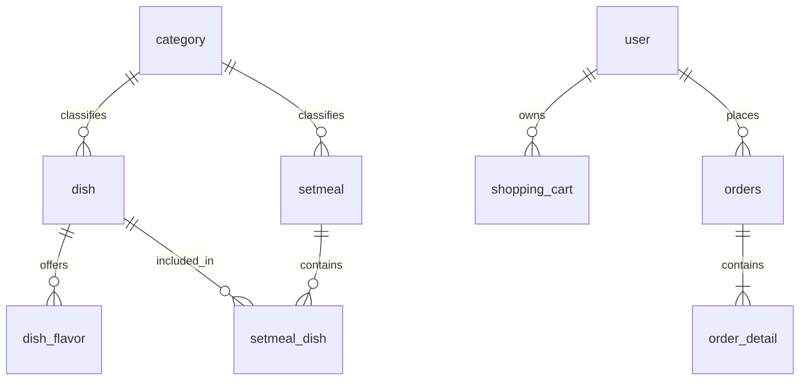

# 数据库设计

当前实际数据库：**sky_takeout_ai**，MySQL 8.0.44，utf8mb4 / utf8mb4_0900_ai_ci，InnoDB。旧库**sky_take_out**不得读写、修改、删除或复用。本机已有新库及下列10张表；没有AI持久化表、评价表、支付表或测试专用表。

## 已建表

| 表 | 主要字段 | 约束与含义 |
| --- | --- | --- |
| user | id、username、password_hash、status、created_at | 用户名唯一；BCrypt；普通用户角色由服务端赋予 |
| employee | id、username、password_hash、status、created_at | 管理账号与user分表；无默认账号；无开放注册 |
| category | id、name、type、sort、status | type=1菜品/2套餐，status=0/1；已创建类型不可修改 |
| dish | id、category_id、name、price、description、image、status | 分类外键；价格DECIMAL(10,2)；status索引；默认下架 |
| dish_flavor | id、dish_id、name、options | 菜品外键，口味组和选项说明；随菜品同事务维护 |
| setmeal | id、category_id、name、price、description、status | 套餐分类外键，DECIMAL(10,2)，默认下架 |
| setmeal_dish | id、setmeal_id、dish_id、quantity | 两个外键，(setmeal_id,dish_id)唯一，数量正数；表示N:N关系 |
| shopping_cart | id、user_id、item_type、item_id、flavor、quantity | 用户外键，数量1..99，商品类型DISH/SETMEAL |
| orders | id、number、user_id、request_key、status、total_amount、address、contact、created_at | number唯一，(user_id,request_key)唯一，用户外键，(user_id,created_at)索引 |
| order_detail | id、order_id、item_type、item_id、name、unit_price、quantity、flavor | 订单外键，保存商品快照，商品ID不设外键以保留历史 |

精确列类型/长度/CHECK见sql/02_auth.sql至06_orders.sql。概念关系不是所有字段都有物理外键：shopping_cart.item_type + item_id的多态商品引用由Service验证；order_detail保留快照，删除菜品不能破坏历史订单。

## 金额、身份与一致性

金额由Java BigDecimal与MySQL DECIMAL表示。订单总额DECIMAL(12,2)，商品单价DECIMAL(10,2)；前端不传可信结算金额。下单时重新读取可售商品和当前价格，保存名称/单价/数量/口味、地址与联系信息快照。

购物车唯一键为(user_id,item_type,item_id,flavor)，flavor采用utf8mb4_bin，避免不同大小写选项被默认校对规则合并。同一用户所有购物车修改和下单先锁用户行，限制并发交错。订单主表、明细、清空购物车在同一个事务中；(user_id,request_key)唯一键提供重复提交保护。

订单状态允许PENDING_PAYMENT、WAITING_ACCEPT、PREPARING、DELIVERING、COMPLETED、CANCELLED。Java限制顺序，SQL更新同时匹配旧状态防止并发覆盖；用户取消只允许前两种状态。没有真实支付，WAITING_ACCEPT通过教学管理员接口推进。

用户ID由已验证JWT解析，私有数据查询必须带当前用户条件。菜品/套餐上下架时检查有效分类与组成；删除被引用分类或菜品时返回冲突，不级联删除历史业务。

## 初始化与演进

01_create_database.sql只创建新库；02—06以USE sky_takeout_ai开头，使用CREATE TABLE IF NOT EXISTS。没有DROP、TRUNCATE、ALTER或旧库写入。重复执行只跳过已存在表，不是迁移工具；修改已有表需要今后明确迁移方案，不擅自执行不可逆迁移。

本次真实MySQL测试多数通过事务回滚清理；缓存与HTTP SSE测试使用独立随机数据并精确清理。浏览器临时账号也已清理。没有插入默认管理员或演示菜单。不会为了展示数据修改旧库。

AI Memory为内存结构，RAG为本地向量存储；未来如需ai_conversation、ai_message、向量数据库或评价系统，应先设计保留期限和隐私边界，本版未建这些表。

经营分析当前查询订单明细聚合，按上海日期和订单创建日期取最近1—90天。金额仅当前已完成订单，不等于实际收入。尚未针对大数据量加统计索引或预聚合，不能宣称已通过大规模性能验证。
