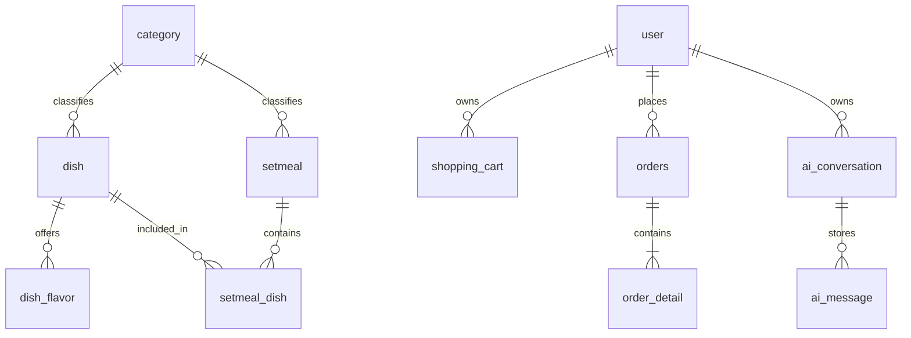

# 数据库设计规划

阶段1仅规划，不创建任何业务表或AI表，不创建system_test。
新项目库：`sky_takeout_ai`。旧库`sky_take_out`不得删除、修改、复用或创建表。
字符集utf8mb4支持中文和表情；MySQL8的utf8mb4_0900_ai_ci提供默认不区分大小写、重音的比较。业务唯一字段将按需要单独明确校对规则。

## 未来核心表

| 表 | 用途与计划字段 | 主要关系 |
| --- | --- | --- |
| user | 用户身份；id、username、password_hash、phone、status、时间字段 | 一个用户拥有多个购物车项和订单 |
| employee | 管理端账号；id、username、password_hash、role、status | 与普通用户身份分离，权限按后续阶段设计 |
| category | 菜品/套餐分类；id、name、type、sort、status | 一个分类关联多个菜品或套餐，type须匹配 |
| dish | 菜品；id、category_id、name、price、description、image、status | 分类1:N菜品；菜品1:N口味 |
| dish_flavor | 可选口味组；id、dish_id、name、options | 属于一个菜品；options格式在菜品阶段确定 |
| setmeal | 套餐；id、category_id、name、price、description、status | 通过setmeal_dish关联多个菜品 |
| setmeal_dish | 套餐组成；id、setmeal_id、dish_id、quantity | 套餐与菜品的N:M中间表 |
| shopping_cart | 用户购物车项；id、user_id、dish_id、setmeal_id、quantity、flavor_selection | dish_id与setmeal_id只允许一个非空 |
| orders | 订单主记录；id、number、user_id、status、total_amount、地址及联系信息快照、时间字段 | 用户1:N订单；订单1:N明细 |
| order_detail | 下单时的商品快照；id、order_id、dish_id、setmeal_id、name、unit_price、quantity、flavor_snapshot | 历史展示不能依赖当前菜品名与价格 |
| ai_conversation | 可选未来会话持久化；id、user_id、title、时间字段 | 用户1:N会话；仅规划 |
| ai_message | 可选未来消息持久化；id、conversation_id、role、content、created_at | 会话1:N消息；仅规划 |

## 主要关系

## 后续建表时落实的规则

- 主键使用BIGINT；金额使用DECIMAL并由Java BigDecimal计算，不用浮点数计算订单金额。
- 用户名、订单号等需要唯一约束；关联查询字段根据实际SQL建立索引，不盲目给全部字段加索引。
- 密码只存安全散列，不存明文。具体算法和认证流程留到登录阶段。
- 用户ID来自认证上下文，订单和购物车操作须校验归属，不能相信客户端或模型传入的userId。
- 订单至少包含待付款、待接单、制作中、配送中、已完成、已取消；状态迁移由业务Service控制。
- 订单明细和收货信息保存快照，避免菜单或地址修改导致历史订单变化。
- 购物车数量必须为正，同款与同口味合并规则在购物车阶段确定；以结算时后端价格为准。
- 套餐组成不能重复，数量必须为正；套餐分类与菜品分类通过类型区分。
- 物理外键、软删除、字段长度和索引DDL随对应业务阶段明确，禁止随意级联删除历史订单。
- AI会话持久化是备选方案，阶段14先评估内存/Redis，不因规划了表就提前创建。

## 阶段3已落地

sql/02_auth.sql只在sky_takeout_ai创建user、employee。username唯一，password_hash为BCrypt，status控制禁用。没有写入默认管理员密码。管理员账号需通过受控初始化流程创建，不能通过普通注册升级角色。
